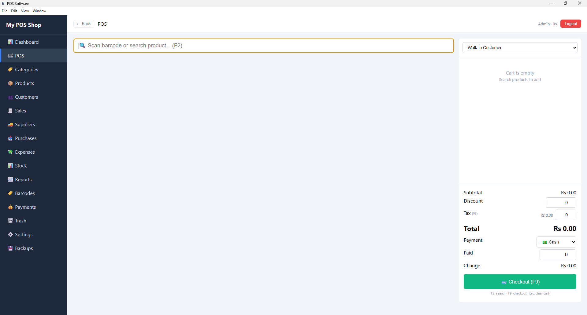
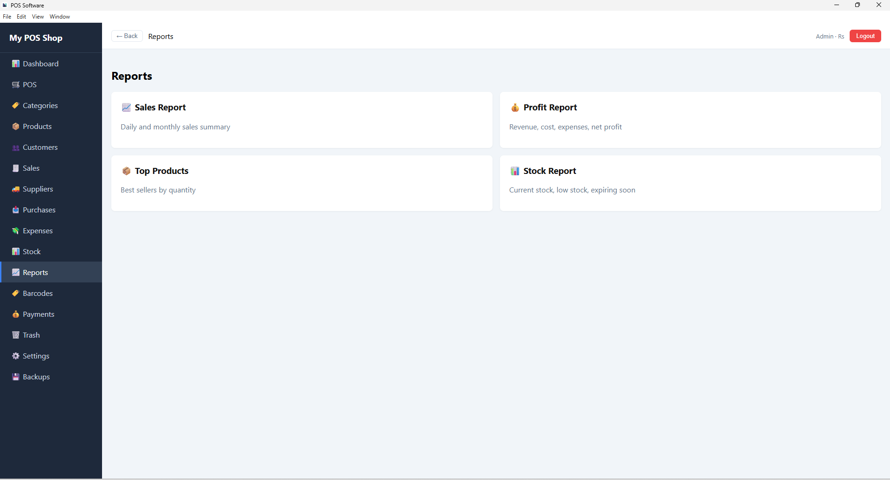
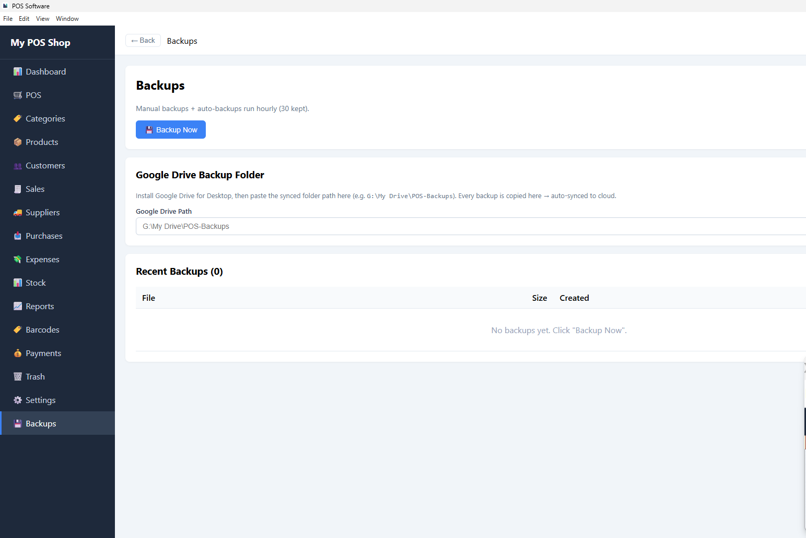
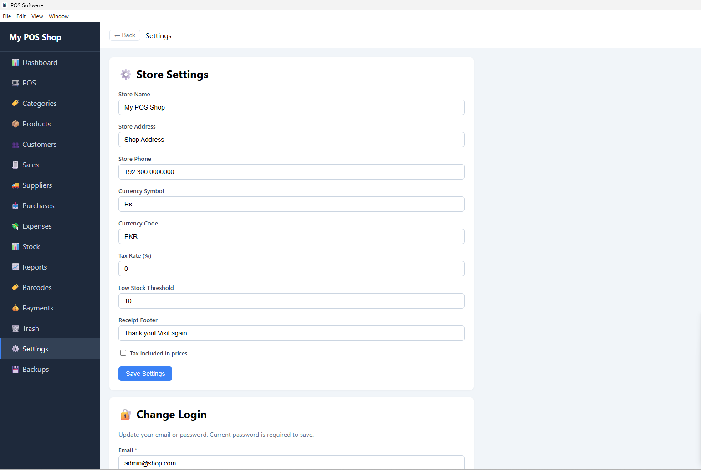

# Laravel POS System — Free Offline Desktop Point of Sale (NativePHP + Windows .exe)

> **Free, open-source Point of Sale software for Windows.** Built with **Laravel 13** and **NativePHP 2**, runs **100% offline** as a native desktop app. Includes barcode scanning, credit khata, thermal receipt printing, stock & expiry tracking, supplier management, and detailed sales reports. Perfect for **small shops, grocery stores, pharmacies, and retail businesses**.

[](https://laravel.com)
[](https://php.net)
[](https://nativephp.com)
[](LICENSE)
[](CONTRIBUTING.md)
[](https://www.microsoft.com/windows)

---

## 📖 Table of Contents

- [Features](#-features)
- [Screenshots](#-screenshots)
- [Tech Stack](#-tech-stack)
- [Requirements](#-requirements)
- [Download](#-download)
- [Developer Setup](#-developer-setup)
- [Building the .exe](#-building-the-exe)
- [Default Login](#-default-login)
- [Project Structure](#-project-structure)
- [Configuration](#-configuration)
- [Updating](#-updating)
- [Roadmap](#-roadmap)
- [Contributing](#-contributing)
- [License](#-license)
- [Credits](#-credits)
- [Contact](#-contact)

---

## ✨ Features

### 🛒 Point of Sale
- Fast product search (name / SKU / barcode / PLU)
- USB barcode scanner support
- Real-time cart with quantity + line totals
- Percentage-based tax calculation
- Flat or per-line discounts
- Cash / Card / Credit (Khata) payment modes
- Auto-generated invoice numbers
- Printable thermal receipt (58mm / 80mm)
- Keyboard shortcuts: **F2** search, **F9** checkout, **Esc** clear cart

### 📦 Inventory
- Products with SKU, barcode, PLU, unit
- Cost + retail price with profit tracking
- Stock quantity + low-stock alerts
- **Expiry date tracking** with visual warnings
- Category grouping
- Barcode generator (CODE128)
- Bulk barcode generation for missing codes
- Barcode label printing (A4 sheets)

### 👥 Customers & Credit
- Customer database
- **Khata (credit) system** — running balance
- Record payments (cash, bank, card, other)
- Reverse payments
- **Printable customer statement**
- Customer purchase history

### 🚚 Suppliers & Purchases
- Supplier management
- Multi-line purchase orders
- Auto stock increment on receipt
- Auto cost price update

### 💸 Financial
- Expenses tracking (rent, utilities, salaries)
- Date-range filtering
- Sales & profit reports

### 📊 Reports
- Sales Report (daily breakdown)
- Profit Report (revenue − cost − expenses)
- Top Products (best sellers)
- Stock Report (value, low stock, expiring, expired)
- Dashboard with 7-day chart

### 🔧 Operations
- Stock adjustments (add, remove, damage, wastage, expired, count)
- Stock movement log
- Soft delete + Trash (restore)
- Delete guards
- Backups (local + Google Drive folder)

### 🔐 Security
- Session-based login
- Change email / password
- Bcrypt hashing
- CSRF protection

### 🖥️ Desktop (NativePHP)
- Native Windows `.exe`
- 100% offline
- SQLite database
- No browser, no server

---

## 📸 Screenshots

### 🛒 POS Screen


### 📊 Reports


### ⚙️ Settings


### 💾 Backups


---

## 🧰 Tech Stack

| Layer | Tech |
|---|---|
| Framework | Laravel 13.x |
| Language | PHP 8.4 |
| Desktop | NativePHP 2.x (Electron) |
| Database | SQLite 3 |
| Frontend | Blade + inline CSS |
| Auth | Laravel session guard |
| Packaging | electron-builder |

---

## 📋 Requirements

### End Users
- Windows 10 / 11 (64-bit)
- ~250 MB disk space
- **No PHP, MySQL, Node, or internet required**

### Developers
- PHP 8.3+ (with `sqlite3`, `pdo_sqlite`, `mbstring`, `openssl`, `curl`, `fileinfo`, `zip`)
- Composer 2.x
- Node.js 18+
- Git

---

## ⬇️ Download

1. Go to [Releases](../../releases)
2. Download `POS Software-1.0.0-setup.exe`
3. Run installer → **More info → Run anyway** (unsigned app)
4. Open from Start Menu
5. Login (see below)

---

## 🛠️ Developer Setup

### 1. Clone

```bash
git clone https://github.com/aimages08/pos-software.git
cd pos-software